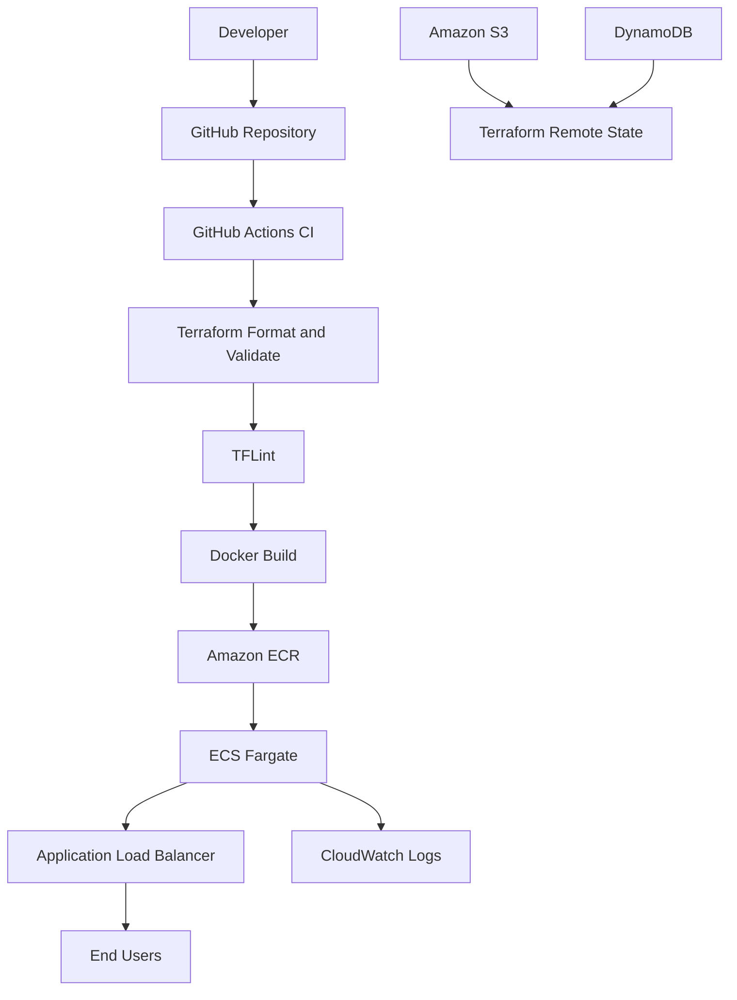

# Zero-Touch Deployments

## Project Overview

Zero-Touch Deployments is an Infrastructure as Code and CI/CD automation project built using Terraform, AWS, Docker and GitHub Actions.

The project automates AWS infrastructure provisioning and application deployment across Dev, Staging and Production environments. Terraform is used to create and manage infrastructure, while GitHub Actions automates validation, Docker image building, publishing and ECS deployment.

## 1. Architecture Diagram



### AWS Infrastructure Components

- **Networking:** VPC, public subnets, Internet Gateway and route table.
- **Security:** IAM roles and security groups.
- **Compute:** Amazon ECS Fargate, ECR and Application Load Balancer.
- **Monitoring:** CloudWatch logs and ECS autoscaling.
- **Remote Backend:** Amazon S3 and DynamoDB.

## 2. Terraform Modules

The project uses four reusable Terraform modules:

| Module | Responsibility |
|---|---|
| Networking | VPC, subnets, Internet Gateway and routing |
| Security | IAM roles and security groups |
| Compute | ECR, ECS cluster, task definition, service and ALB |
| Monitoring | ECS autoscaling configuration |

### Terraform Workspaces

Three workspaces are used to manage environments independently:

- dev
- staging
- production

Each workspace maintains separate Terraform state and environment-specific resource names.

## 3. Remote State Management

Terraform state is stored remotely in Amazon S3.

| Configuration | Value |
|---|---|
| S3 Bucket | iaac-pipeline-tfstate |
| DynamoDB Table | iaac-pipeline-locks |
| AWS Region | ap-south-1 |
| Encryption | AES256 |
| Versioning | Enabled |

DynamoDB locking prevents concurrent Terraform operations from modifying the state simultaneously.

## 4. CI/CD Pipeline Flow

### Continuous Integration

The CI pipeline runs when code is pushed or a pull request is created for the main or staging branches.

The pipeline performs:

1. Checkout source code.
2. Setup Terraform.
3. Check Terraform formatting.
4. Initialize Terraform without the remote backend.
5. Validate Terraform configuration.
6. Run TFLint.
7. Build the Docker image.

### Continuous Deployment

The deployment pipeline supports staging and production environments.

**Staging Deployment**

1. Developers create changes and raise a pull request to staging.
2. CI checks validate the changes.
3. After merging into staging, CD builds the Docker image.
4. The image is pushed to the staging ECR repository.
5. The staging ECS service is updated.
6. ECS deployment health is checked.

**Production Deployment**

1. Changes from staging are merged into main.
2. GitHub Actions waits for production environment approval.
3. After approval, the Docker image is built and pushed to production ECR.
4. The production ECS service is updated.
5. Deployment status is checked.

### Pipeline Flow

```text
Code Changes
     |
     v
Pull Request to Staging
     |
     v
CI Validation
     |
     v
Merge into Staging
     |
     v
Staging ECS Deployment
     |
     v
Pull Request to Main
     |
     v
Merge into Main
     |
     v
Production Approval
     |
     v
Production ECS Deployment
     |
     v
Health Check
     |
     v
Deployment Complete
```

## 5. Setup Instructions

### Prerequisites

Install and configure:

- Rocky Linux or another Linux environment
- Git
- Terraform
- AWS CLI
- Docker
- GitHub account
- AWS account

### Clone Repository

```bash
git clone git@github.com:Amey78/IaaC-pipeline.git
cd IaaC-pipeline
```

### Configure AWS CLI

```bash
aws configure
```

Configure the AWS access credentials and region `ap-south-1`.

Never commit AWS access keys or secret keys to the repository.

### Initialize Terraform

```bash
cd terraform
terraform init
```

### Validate Configuration

```bash
terraform fmt -recursive
terraform validate
tflint --recursive
```

### Create and Select Workspaces

```bash
terraform workspace new dev
terraform workspace new staging
terraform workspace new production
```

To select an existing workspace:

```bash
terraform workspace select dev
terraform workspace select staging
terraform workspace select production
```

### Deploy Infrastructure

Select the required workspace and run:

```bash
terraform plan
terraform apply
```

### Configure GitHub Secrets

Add the following secrets under GitHub Repository Settings → Secrets and variables → Actions:

- AWS_ACCESS_KEY_ID
- AWS_SECRET_ACCESS_KEY

Configure the GitHub production environment with required deployment reviewers.

## 6. ECS Health Checks and Autoscaling

The ECS services use Application Load Balancer target group health checks.

The monitoring module configures ECS service autoscaling:

| Setting | Value |
|---|---|
| Minimum Tasks | 2 |
| Maximum Tasks | 6 |
| CPU Target Utilization | 60% |
| Launch Type | Fargate |

CloudWatch collects application logs for monitoring and troubleshooting.

## 7. Rollback Strategy

The CD workflow saves the previous ECS task definition before starting a deployment.

A new task definition revision is registered with the newly built Docker image.

The deployment workflow checks the ECS rollout status for up to five minutes.

If deployment fails or times out, the workflow initiates rollback by updating the ECS service to use the previous task definition.

This helps restore the previous application revision when a deployment is unsuccessful.

## 8. Runbook

### Terraform Validation Failure

1. Check Terraform configuration files.
2. Run `terraform fmt -recursive`.
3. Run `terraform validate`.
4. Run `tflint --recursive`.
5. Review the error and correct the configuration.

### Docker Build Failure

1. Check the Dockerfile.
2. Verify application files.
3. Run `docker build` locally.
4. Review the build error and rebuild the image.

### ECR Push Failure

1. Verify AWS credentials.
2. Check ECR repository availability.
3. Authenticate Docker with Amazon ECR.
4. Retry the image push.

### ECS Deployment Failure

1. Open GitHub Actions and inspect deployment logs.
2. Check ECS service events.
3. Verify the task definition and Docker image.
4. Inspect CloudWatch logs.
5. Check the ECS service rollout status.
6. Verify whether the previous task definition has been restored.

### Application Health Check Failure

1. Verify that the application listens on port 80.
2. Check ECS task status.
3. Inspect target group health.
4. Review container logs in CloudWatch.
5. Correct the application or configuration issue.

## 9. Estimated Monthly AWS Cost

The following is an approximate planning estimate for running three environments continuously in the Mumbai region. Actual charges depend on AWS pricing, usage, traffic and storage.

| AWS Resource | Estimated Monthly Cost (USD) |
|---|---:|
| ECS Fargate (6 tasks) | $65–75 |
| Application Load Balancers (3) | $55–65 |
| Public IPv4 addresses | $20–25 |
| ECR storage | $2–5 |
| CloudWatch Logs | $3–10 |
| S3 and DynamoDB | $1–3 |
| Data transfer and other usage | $5–15 |
| **Estimated Total** | **$151–198** |

The estimated total is approximately ₹13,000–₹17,000 per month, depending on usage and exchange rates.

These figures are indicative estimates, not guaranteed AWS charges. Actual costs should be checked using AWS Cost Explorer and the AWS Pricing Calculator.

## 10. Security

- AWS credentials are stored in GitHub Secrets.
- S3 public access is blocked.
- Terraform state encryption is enabled.
- DynamoDB state locking is configured.
- ECS tasks use an IAM execution role.
- Security groups restrict inbound application traffic.
- GitHub production deployment requires approval.

## Conclusion

The Zero-Touch Deployments project demonstrates automated infrastructure provisioning and application delivery using Terraform, AWS and GitHub Actions.

It provides separate Dev, Staging and Production environments, reusable Terraform modules, remote state management, automated CI/CD, ECS health checks, autoscaling and deployment rollback.

The project reduces manual deployment activities and provides a consistent approach to managing cloud infrastructure and application releases.
